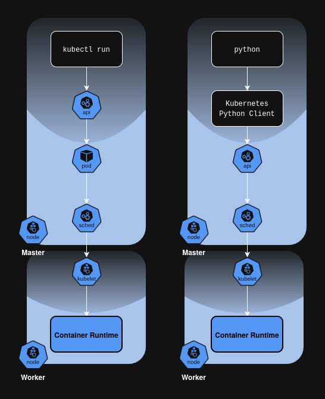

# Prototype Python

Ce projet permet de récupéré le PID d'un conteneur dans un pod donné

## I. **Présentation**

### 1. **Contexte** :

Afin de répondre à la chaîne de résolution **pod → node → container ID → PID hôte → cgroup** pour développer le projet d'observabilité d'un pod au niveau du noyau.

### 2. **Problème :**

Le PID du processus du conteneur n'est pas exposé nativement par `kubectl`. Pour le récupérer via le runtime CRI, il faut actuellement accéder à la node hébergeant le conteneur, puis interroger le runtime avec `crictl`.

```bash
ssh <node>
sudo -i
crictl ps -a
crictl inspect <container_id> | grep "pid"
```

- **4 commandes**
- **1 connexion SSH**
- **1 élévation de privilèges**
- **1 accès à la node du cluster**
- **1 accès root requis**
- **1 identifiant/credential SSH à maintenir**

*Dépendances d'accès et privilèges  :*

| Élément   | Classification                               |
| --------- | -------------------------------------------- |
| SSH       | **Identifiant / secret d'accès à la node**   |
| `sudo -i` | **Privilèges élevés / accès root**           |
| `crictl`  | Outil nécessitant des **privilèges système** |

### 3. **Objectif** :

Utiliser l'API Kubernetes comme intermédiaire pour exécuter une commande CRI sur la node cible.

## II. **Fonctionnalités :**

- Parse les argument :
	- nom du pod cible
	- `-n` ou `--namespace` pour nom du namespace du pod cible (pas d'agument namespace = `default`)

- Lit le pod cible pour récupérer les infos requise :
	- nom de la node
	- id du conteneur

- Création d'objets Kubernetes
	- Création d'une configmap, injecté dans un pod d'analyse (préviens les sortie d'erreur `stderr` lors de la récupération du PID dans le json retourné sur `stdout`)
	- Création d'un pod d'analyse qui va excécuter la commande `crictl inspect <container_id>`

- Récupération et affichage du PID du conteneur dans la sortie json de la commande `crictl inspect <container_id>`

- Suppression des objets Kubernetes créés

- Traitement des erreurs selon les phases des pods

## III. Modèle de sécurité

Pour rappel, la méthode de récupération manuelle depuis la CLI nécéssite des privilèges. Cet outil ne supprime pas ces privilèges, il les déplace : le pod d'analyse monte le socket containerd de la node via `hostPath`.
Créer un pod avec `hostPath` depuis l'API demande des droits RBAC qui sont eux aussi sensibles.

Droits RBAC minimaux requis par l'appelant : `get pods`, `create pods`, `create configmaps`, `get pods/log`, `delete`.

## IV. **Architecture du projet**

Cette version du script étant un POC, j'ai utilisé l'orchestration Kubernetes pour me rapprocher du runtime sans avoir à gérer moi-même une connexion SSH vers la node.

*Outils d'orchestration utilisés :*

| API                            | Client               |
| ------------------------------ | -------------------- |
| `read_namespaced_pod`          | `kubectl get`        |
| `create_namespaced_config_map` | `kubectl create cm`  |
| `create_namespaced_pod`        | `kuebctl create pod` |
| `delete_namespaced_config_map` | `kubectl delete cm`  |
| `delete_namespaced_pod`        | `kubectl delete pod` |
Pour pouvoir récupérer le process id du conteneur j'ai cherché à reproduire le comportement de la commande `kubectl run` avec `create_namespaced_pod()`.

>[!Note]
>`kubectl run` est une commande impérative qui permet de créer une ressource
 Kubernetes depuis la CLI. Si aucuns arguments sont invoqués, elle crée un pod dans le namespace par défaut. 
>Pour ce projet, cette commande est idéale pour pour rapidement créer un pod dans une node et namespace ciblé afin de récupérer des informations inaccesibles depuis l'exterieur.
>
>`kubectl run` 
>- Construit une définition de Pod à partir des paramètres fournis (une image, une commande, des labels, des variables d'environnement,etc.).
>- Envoie cette définition à l'API Kubernetes, dans le namespace ciblé.
>- Le contrôleur/kubelet prend en charge le Pod
>
>Exemple : Pour exécuter une commande dans un Pod créé avec kubectl run
>```bash
>kubectl run hellopod --image=busybox --restart=Never --command -- sh -c >"echo hello"
>```
>Dans cet exemple :
>- Construire le manifeste du Pod
>- Envoyer `create_namespaced_pod()`
>- Attendre que le Pod atteigne `Succeeded` ou `Failed`
>- Récupérer les informations sur `stdout` et/ou `stderr`




- Cibler la ressource
	- Entrer le nom ciblé du pod et son namespace
- Récupérer les informations nécéssaires
	- Lire le manifest du pod 
	- Récupérer le nom de node et l'ID du conteneur
- Résoudre la dépenance crictl -> créer une configmap
- Exécuter `kubectl run` 
	- Construire le manifeste du Pod
	- Envoyer `create_namespaced_pod()`
	- Attendre que le Pod atteigne `Succeeded` ou `Failed`
	- Récupérer les informations sur `stdout` et/ou `stderr`
- Traitement de la sortie json
- Supprimer le Pod

```python
def main():
	# Parser les arguments
    args = parse_args()
    target_name = args.pod_name
    target_namespace = args.namespace
    # Chargement de l'API Kubernetes
    config.load_kube_config()
    core_v1 = core_v1_api.CoreV1Api()
    # Récupération du caintainer_id
    container_id = get_containerid(core_v1, target_name, target_namespace)
    container_id = container_id.split("://", 1)[-1]
    node_name = get_node_name(core_v1, target_name, target_namespace)
    # Création de la configamap 
    conf_name = create_configmap(core_v1)
    # Emlulation de la commande kubectl run
    run_commands(core_v1, container_id, node_name, conf_name)
```

## V. **Démonstration**

Exemple d'utilisation :
```bash
> python3 podAnalystAgent.py kube-flannel-ab-1234 -n kube-flannel
> 6789 #PID du conteneur dans le pod kube-flannel-ab-1234 
```

## VI. **Prérequis**

- Version Python -> 3.14
- Dépendances -> [kubernetes-python-client](https://github.com/kubernetes-client/python/tree/master)
- Outils externes nécessaires -> cluster 2 nodes kubeadm + CRI (ici containerd) + CNI (ici flannel)
- kubectl
## VII. **Installation**

**Clone :**
```bash
git clone https://github.com/TomGn1/projectPodAnalyst.git
```
**Installation des dépendances :**
```bash
cd ./projectPodAnalyst/legacy/python
source .venv/bin/activate
pip install kubernetes
```

**Configuration éventuelle :**

`kubectl`doit être configuré sur le poste d'administration
Copier le contenu du fichier `admin.conf` de la node master et utiliser le fichier comme KUBECONFIG 

1. Configuration de base :
```bash
# SSH sur la node maître
vagrant ssh master*
su -
cat /etc/kubernetes/admin.conf
# Copier le contenu du fichier
exit
exit
# Sur le localhost
vi ~/.kube/config
# Coller le contenu
```

2. Configuration mutli-cluster :
```bash
# SSH sur la node maître, ici avec vagrant
vagrant ssh master
su -
cat /etc/kubernetes/admin.conf
# Copier le contenu du fichier
exit
exit
# Sur le localhost
vi ~/.kube/admin.conf
export KUBECONFIG=~/.kube/config:~/.kube/admin.conf
# La rendre persistante
# Changer le contexte
kubectl config get-contexts
```
 
## VIII. **Utilisation**

Commande de lancement :
```bash
python3 podAnalystAgent.py <pod> -n <namespace>
python3 podAnalystAgent.py <pod> --namespace <namespace>
```

Dans le cas où le pod ciblé est dans le namespace `default`:
```bash
python3 podAnalystAgent.py <pod> 
```

## IX. **Fonctionnement**

### 1. **Récupèration des informations :**

L'analysteur va chercher les informations du pod cible via l'API Kubernetes. 
Il utilise le module `core_v1.read_namespaced_pod`

>[!Note]
>`core_v1.read_namespaced_pod()` est une méthode de l’API Kubernetes qui permet de **récupérer les informations d’un Pod précis dans un namespace donné**.
>
>Elle prend notamment en paramètres :
>
>- `name` → nom du Pod
>- `namespace` → namespace dans lequel il se trouve
>
>Elle retourne un objet contenant **l’état et les informations détaillées du Pod** : conteneurs, IP, nœud, statut, conditions, etc.

Il récupères 2 valeurs nécéssaire : `container_id` et `node_name` 

La valeur container_id récupérée sur stdout est sous la forme d'une URI `CRI://container_id`.
Le `container_id` est récupéré en effectuant une soustraction du préfixe de l'URI :
```python
container_id = container_id.split("://", 1)[-1]
```

### 2. **Interprétation des données du pod :**

La fonction `run_command`crée un pod qui execute la commande `crictl inspect <container_id>`. 
Quand la phase de ce pod est `Succeeded`la commande s'est exécutée. La sortie de la commande affiche un json dans lequel on va chercher le nom du PID qui se trouve sous :
```json
{
info: {
	pid:
	}
}
```

```bash
if resp.status.phase == "Succeeded":
    rd = api_instance.read_namespaced_pod_log(
        name=name, namespace="default", _preload_content=False
    )
    logs = rd.data.decode("utf-8")
    logs = json.loads(logs)
    print(logs["info"]["pid"])
    sys.exit(0)
```

`stdout` affiche la valeur du PID

### 3. **Gestion des différents états/erreurs**

Le pod crée dans `run_command` peut être une source d'erreur, les principaux cas ont été traités :
- Phases :
	- Failed
	- Pending
	- Running
- Timeout après 30 secondes

Chacunes de ces erreurs renvoient les information d'erreur du pod récupérées depuis l'API Kubernetes 

*Exemple de traitement d'un pod dont la phase est `Failed` :*
```python
elif resp.status.phase == "Failed":
    if resp.status.container_statuses[0].state is not None:
        if resp.status.container_statuses[0].state.terminated is not None:
            print(
                f"Reason: {resp.status.container_statuses[0].state.terminated.reason}\n"
                f"Message: {resp.status.container_statuses[0].state.terminated.message}\n"
                f"Exit code: {resp.status.container_statuses[0].state.terminated.exit_code}"
            )

            exit_code = resp.status.container_statuses[0].state.terminated.exit_code
            sys.exit(exit_code)

        else:
            print("Container state unavailable")
    else:
        print("No container status available")
```

*Exemple de traitement d'un pod dont la phase est `Pending` :*
```python
elif elapsed >= timeout_seconds:
    if resp.status.phase == "Pending":
        if resp.status.container_statuses[0].state is not None:
            if resp.status.container_statuses[0].state.waiting is not None:
                print(
                    f"Reason: {resp.status.container_statuses[0].state.waiting.reason}\n"
                    f"Exit code: 124"
                )
        else:
            print(
                f"Timeout after {timeout_seconds} seconds.\n"
                f"Last observed phase: {resp.status.phase}."
            )
```

### 4. **Nettoyage des objets Kubernetes :**

Quelque soit les erreurs ou le résultat, le pod et la configmap créés doivent être nettoyés afin de ne pas saturer le cluster d'objets obsolètes.
L'API Kubernetes fournie `api_instance.delete_namespaced_pod`et `api_instance.delete_namespaced_config_map` pour supprimer les ressources concernées.

```python
finally:
    api_instance.delete_namespaced_pod(
        name=name,
        namespace="default",
        grace_period_seconds=0,
        body=V1DeleteOptions(propagation_policy="Background"),
    )
    api_instance.delete_namespaced_config_map(
        name=conf_name,
        namespace="default",
        grace_period_seconds=0,
        body=V1DeleteOptions(propagation_policy="Background"),
    )
```

## X. **Tests**

Pour tester les retour des différentes phases du pod créé, la variable `pod_manifest` peut être modifiée avec les éléments suivants :

| Cas                   | Comment le provoquer                          | Vérification              |
| --------------------- | --------------------------------------------- | ------------------------- |
| Succeeded             | `echo hello`                                  | logs, `exit_code = 0`     |
| Failed                | `exit 42` ou commande inexistante             | `reason`, `exit_code`     |
| Pending               | image inexistante ou impossible à télécharger | `phase`, `waiting.reason` |
| Running + timeout     | `sleep 300`                                   | timeout, dernière phase   |
| CrashLoopBackOff      | `restartPolicy: Always` + `exit 1`            | voir les états retournés  |
| Container introuvable | mauvais `container_id`                        | erreur `crictl inspect`   |
| Pod cible inexistant  | mauvais nom de pod                            | erreur API Kubernetes     |
| Namespace inexistant  | mauvais namespace                             | erreur API Kubernetes     |

## XI. **Choix techniques**

Quelques décisions intéressantes du projet
- L'image Busybox ne présente pas une installation `crictl`, les volumes sont montés dans le pod pour être en mesure de l'utiliser.
- `hostPID: True` était initialement décrit elle assumait une élévation de privilèges `root` afin de récupérer l'information. Les testes on démontrés que la valeur `hostPID: false` suffit, puisque le PID est remonté par le socket containerd et pas lu dans `/proc`
- `crictl` cherche `/etc/crictl.yaml` ; sans ce fichier il tente une auto-détection des endpoints et émet un `WARN` avant de sortir le JSON. La ConfigMap sert donc à injecter ce fichier de config avec le `runtime-endpoint` explicite.
- `read_namespaced_pod_log` ne renvoie pas deux flux séparés, le kubelet fusionne stdout et stderr dans les logs du conteneur. Donc le `WARN` se retrouve en tête du flux et casse `json.loads`.
- Gestion du timeout

Typage / structures de données
- Pourquoi une seul fonction `run_commands` -> POC, permet de tester comment  récupérer le PID d'un conteneur via l'API Kubernetes

## XII. **Limites connues/Roadmap**

- Un seul conteneur géré (`container_statuses[0]`), pas de flag `-c` pour les pods multi-conteneurs
- Le pod d'analyse est créé en dur dans `default` alors que la cible est paramétrable.
- Le PID n'a de sens que dans le contexte de la node, et devient invalide au moindre redémarrage du conteneur
- Pas de vérification que le pod cible est bien `Running` avant l'inspection
- Pas de code de sortie stable/parsable pour un usage scripté
- Tout dans une seule fonction : `run_commands`

## XIII. **Ce que j'ai appris**

- La chaîne `containerID` URI → runtime
- La fusion stdout/stderr côté kubelet
- Le `finally` obligatoire pour ne pas laisser d'objets orphelins


